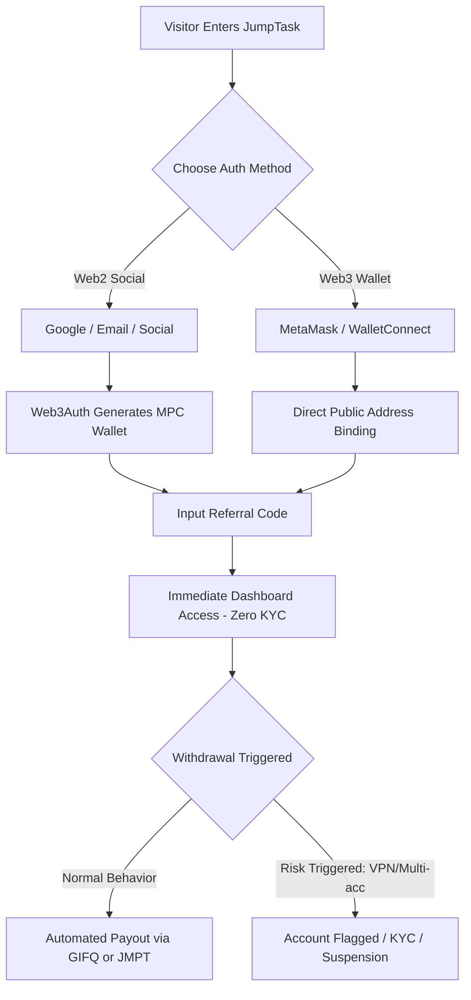
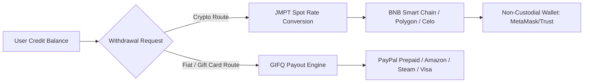

# COMPETITIVE INTELLIGENCE REPORT: JUMPTASK (JMPT)
**Document Reference:** `VELOOP-CIR-2026-JT01`  
**Target Platform:** JumpTask (`jumptask.io` / `app.jumptask.io`)  
**Analyst:** Senior Competitive Intelligence & Product Research Team  
**Prepared For:** CEO, Product Team, and Management of VELoop Rewards  
**Evaluation Date:** November 4, 2026  
**Status:** COMPLETE & VERIFIED  

---

## EXECUTIVE SUMMARY & STRATEGIC HIGHLIGHTS

JumpTask represents a hybrid Web2/Web3 micro-gig and Get-Paid-To (GPT) platform launched in January 2022 by **JMPT Technologies OÜ** (Estonia) and operationally anchored through **Hiville, UAB** (Lithuania). Co-founded by **Juozapas M. Preikša** and currently led by CEO **Laurynas Janušonis**, the platform positions itself as a decentralized gig marketplace connecting enterprise clients requiring distributed human micro-labor (AI model training, app load-testing, brand engagements) with over 5 million registered global earners across 150+ countries.

### Critical Strategic Findings for VELoop:
1. **The Staking Pivot & Discontinuation:** While marketed widely between 2022 and 2024 for its "Fluid and Locked Crypto Staking," JumpTask **officially discontinued new staking pools on January 13, 2025, and completely sunset its in-app staking dashboard on January 31, 2026**. This pivot was forced by regulatory liabilities, volatile token depreciation of $JMPT, and high gas friction for low-tier earners. VELoop (which currently features `/staking` and `/contribution-vault` on its roadmap) must treat this as a prime cautionary case: yield-bearing token mechanisms in GPT ecosystems suffer severe adverse selection and regulatory scrutiny.
2. **Stable Credit Abstraction:** JumpTask transitioned its internal accounting to a stable credit system (**1,000 Credits = $1.00 USD**) to shield earners from token price swings, while offloading payout fulfillment to **GIFQ** (`redeem.gifq.com`) for gift cards, PayPal prepaid cards, and fiat equivalents.
3. **The Honeygain Strategic Moat:** JumpTask's primary acquisition engine is its exclusive native API integration with **Honeygain**, allowing passive residential bandwidth sellers to route earnings directly to JumpTask for instant, low-barrier payouts ($0.50 minimum).
4. **Automated Fraud Friction vs. Churn:** Trustpilot (1.9/5 score) and Reddit reviews reveal extreme user backlash caused by trigger-happy automated fraud filters that ban users upon reaching withdrawal thresholds without human recourse.

---

## 1. COMPANY & PRODUCT OVERVIEW

### 1.1 Corporate Structure & Legal Jurisdiction
* **Legal Operating Entities:**
  * **JMPT Technologies OÜ** (Registry Code: 16417156, incorporated January 5, 2022, Harju maakond, Tallinn, Estonia).
  * **Hiville, UAB** (Operational management, Vilnius, Lithuania).
* **Leadership:**
  * **Current CEO:** Laurynas Janušonis (leading commercial expansion, Credit model transition, and enterprise client acquisition).
  * **Co-Founder & Former CEO:** Juozapas M. Preikša (spearheaded initial token launch, BSC deployment, and Honeygain partnership).
* **Launch Date:** January 13, 2022.
* **Capitalization & Token Supply:** Native token **$JMPT** launched with a fixed maximum supply of **100,000,000 tokens** across BNB Smart Chain (BSC), Polygon, and Celo.

### 1.2 Target Audience & Demographics
* **Primary Earners:** Smartphone and desktop users across Tier-2 and Tier-3 markets (Latin America, Southeast Asia, South Asia, Eastern Europe) seeking supplemental income through micro-tasks.
* **Secondary Earners:** Crypto enthusiasts and passive-earning users leveraging automated bandwidth sharing (Honeygain).
* **Demand-Side Clients:** Web3 projects seeking rapid social verification/airdrop farming, enterprise AI developers seeking data annotation, and mobile game publishers seeking Cost-Per-Engagement (CPE) installs.

### 1.3 Operating Reach & Devices
* **Supported Devices:** Web Responsive Application (`app.jumptask.io`) optimized for desktop and mobile browsers; native Android APK (`JumpTask: Earn Money & Crypto` on Google Play).
* **Geographic Availability:** Global (150+ countries). However, earning volume is heavily bifurcated: Tier-1 regions (US, UK, Germany, Canada) receive high-value CPE offers ($5.00–$50.00+), whereas Tier-3 regions (India, Nigeria, Pakistan, Philippines) primarily receive low-yield surveys and microtasks ($0.02–$0.30).

---

## 2. REGISTRATION & ONBOARDING ARCHITECTURE

### 2.1 Authentication Methods
JumpTask implements a **hybrid authentication gateway**:
1. **Web3 Native Non-Custodial Wallets:** Direct connection via MetaMask, WalletConnect, Coinbase Wallet, or Torus.
2. **Web2 Social Authentication:** Google OAuth, Facebook Login, X (Twitter), or Email Magic Link.
   * *Architecture Note:* Web2 sign-ins utilize **Web3Auth / Torus MPC (Multi-Party Computation)**, automatically provisioning a non-custodial cryptographic wallet address tied to the user's social identity without requiring the user to record a 12-word mnemonic phrase.

### 2.2 Onboarding Friction Analysis
* **Initial KYC Friction:** **Zero KYC at signup**. Users can register and begin earning within 15 seconds.
* **Referral Attribution:** Input of a 6-character referral code or deep-link parameter applies an instant **+10% earning bonus on the first completed task**.
* **Identity Verification Triggers:** JumpTask defers identity verification (Sumsub / internal KYC) until the user triggers specific fraud risk conditions: high withdrawal velocity, VPN/proxy flags, or high-value gift card redemptions.

---

## 3. DASHBOARD ARCHITECTURE & NAVIGATION

### 3.1 Interface Structure
The user interface is structured as a single-page React application with a dark-mode Web3 aesthetic:
* **Top Navigation Bar:**
  * Dual-Currency Balance Display: Real-time Credit balance (USD-pegged) and $JMPT token balance.
  * Network Indicator: BNB Smart Chain / Polygon / Celo network selector.
  * Profile & Notification Dropdown.
* **Primary Navigation Menu:**
  * **Earn (Tasks & Offers):** Aggregated task feed categorized by task type.
  * **Offers:** Direct third-party offerwalls (Torox, AyeT-Studios, etc.).
  * **Staking (Sunset/Read-Only):** Directs legacy users to BSC smart contracts.
  * **Referrals:** Referral code, tracking dashboard, earnings attribution table.
  * **Leaderboard:** Weekly gamified competitions with prize pool allocations.
  * **Payout:** Cash-out hub interfacing with GIFQ.

### 3.2 Dual-Currency Accounting Mechanism
JumpTask resolved a major user experience bottleneck by introducing **Credits**:
$$\text{Account Value} = \frac{\text{Credits}}{1,000} \text{ USD}$$
* Earners view task rewards in fixed USD terms (Credits) rather than fluctuating JMPT amounts.
* Upon withdrawal, users choose whether to convert Credits into native $JMPT (calculated at spot market DEX price) or redeem for gift cards/prepaid cards via GIFQ.

---

## 4. EARNING OPPORTUNITIES & MECHANISMS

| Earning Category | Operational Mechanism | Payout Range (USD) | Primary Provider / Engine | Verification & Crediting Time |
| :--- | :--- | :--- | :--- | :--- |
| **Play Games (CPE)** | Install mobile game, complete specific progression levels within 7–30 days. | $1.00 – $75.00 | Torox, AyeT-Studios, Direct Advertisers | 24 to 72 hours post-milestone; subject to advertiser chargeback |
| **Surveys** | Demographic screening questions followed by market research surveys. | $0.20 – $3.50 | CPX Research, BitLabs | Instant upon completion; disqualifications grant 1–5 credits |
| **App Installs & Trials** | Download, register, or start trial subscriptions on fintech/utility apps. | $0.50 – $15.00 | Torox, OfferToro legacy | Instant to 48 hours |
| **Train AI (Micro-tasks)** | Image categorization, LLM response evaluation, POV video capture. | $0.05 – $2.00 | Native JumpTask Enterprise Clients | Semi-automated batch approval (24–48 hours) |
| **Micro-tasks & Social** | Follow Twitter/X accounts, join Telegram/Discord, engage with content. | $0.02 – $0.25 | Direct Web3 Community Sponsors | Automated API check (instant) |
| **Passive Bandwidth** | Background sharing of unused residential internet connection. | $0.10 – $0.50 / day | Honeygain Native API | Continuous real-time credit streaming |
| **Rewarded Videos** | Watch 15–30 second promotional video advertisements. | $0.001 – $0.005 / ad | Lootably, AdGem | Instant credit |

---

## 5. FEATURES & GAMIFICATION SYSTEMS

### 5.1 Referral Program (10% Tier-1 Lifetime RevShare)
* **How It Works:** Every registered user receives a unique referral link and 6-character alphanumeric code.
* **Referrer Reward:** 10% lifetime recurring commission on all eligible earnings accumulated by the referred user, funded from JumpTask's platform margin (not deducted from the referee).
* **Referee Reward:** One-time +10% bonus credit on the referee's first verified task.
* **Abuse Controls:** IP tracking, hardware fingerprinting, and automated checks prevent self-referral rings. Accounts using identical payout wallets or sharing IP ranges are permanently blocked.

### 5.2 Weekly Leaderboard Competitions
* **Mechanic:** Dynamic leaderboard ranking users based on Credits earned during a 7-day rolling window.
* **Prize Pool:** Weekly fixed rewards in Credits/$JMPT distributed among top 20 earners (1st place typically receives 20,000–50,000 Credits / $20–$50).
* **Business Objective:** Drives retention and competition among power users, encouraging high-volume multi-day task engagement.

### 5.3 Daily Check-in Streaks
* **Mechanic:** Consecutive 24-hour login bonus awarding incremental Credits (Day 1: 5 credits $\to$ Day 7: 50 credits + bonus multiplier).
* **Reset Trigger:** Strict 36-hour grace window; failure to claim within the window resets the cycle to Day 1.

---

## 6. OFFERWALL & ADVERTISING PARTNERS

JumpTask utilizes a hybrid partner architecture, combining global offerwall aggregators with direct enterprise campaigns:

1. **Torox (formerly OfferToro) — [CONFIRMED ACTIVE]:**
   * Primary partner for mobile gaming (CPE) and fintech app trials.
   * Full in-app iframe integration with dedicated "My Activity" tracker showing Pending, Approved, and Rejected statuses.
2. **AyeT-Studios — [CONFIRMED ACTIVE]:**
   * Focuses on rewarded mobile Android game installations with multi-tier milestone tracking.
3. **CPX Research — [CONFIRMED ACTIVE]:**
   * Powers the dedicated survey routing section with partial compensation for demographic screen-outs.
4. **BitLabs — [CONFIRMED ACTIVE]:**
   * Alternative survey router and rewarded brand interaction provider.
5. **Lootably — [CONFIRMED ACTIVE]:**
   * Powers short rewarded video feeds and interactive micro-actions.
6. **Honeygain — [CONFIRMED STRATEGIC PARTNER]:**
   * JumpTask's anchor partner. Honeygain users toggling "JumpTask Mode" receive low-minimum withdrawals, bypassing Honeygain's standard $20 threshold.
7. **GIFQ (`redeem.gifq.com`) — [CONFIRMED FULFILLMENT PARTNER]:**
   * Third-party payout orchestration partner handling gift card catalog sourcing and prepaid digital cash.

---

## 7. WALLET, PAYOUT & TOKENOMICS MECHANISMS

### 7.1 Payout Thresholds & Fees
* **First Withdrawal Minimum:** **1,000 Credits ($1.00 USD)**.
* **Subsequent Withdrawal Minimum:** **500 Credits ($0.50 USD)**.
* **Crypto Gas Fee Handling:** To resolve the historical issue of users lacking native BNB/MATIC for gas fees, JumpTask implemented **Gasless Fee Deduction**—the gas fee is deducted directly from the withdrawn JMPT balance at current exchange rates.
* **Gift Card Delivery:** Handled digitally via email vouchers through GIFQ within 5 minutes to 24 hours.

### 7.2 The Tokenomics Reality ($JMPT)
* **Total Supply:** 100,000,000 JMPT.
* **Allocation:** 50% Product & Partnerships, 20% Team (vested), 16% R&D, 12% Marketing, 2% Liquidity Pools.
* **Staking Sunset Analysis:** JumpTask originally offered "Fluid Staking" (no lockup) and "Locked Staking" (30–180 days with tiered APY). However, staking in a GPT environment suffered from economic death spirals: task earners sold staking rewards immediately on PancakeSwap, driving down JMPT price and eroding staking yields. The operational and legal burden led to the full discontinuation of staking in January 2026.

---

## 8. MONETIZATION & BUSINESS MODEL

JumpTask operates on a **high-volume micro-margin revenue arbitrage model**:

1. **Offerwall Margin Arbitrage (Core Revenue):**
   * Offerwall networks (Torox, AyeT, CPX) pay JumpTask on a CPA/CPL basis.
   * JumpTask retains a platform spread of **25% to 40%** of gross advertiser payout, distributing 60% to 75% to the user in Credits.
2. **Direct Enterprise Client Campaigns:**
   * Enterprise AI clients contract JumpTask directly for dataset labeling and model validation. JumpTask captures gross margins exceeding **50%–60%** by eliminating third-party offerwall broker fees.
3. **Treasury Management & Token Utility:**
   * JMPT held in platform reserves appreciates with ecosystem adoption.
4. **Withdrawal Transaction Spreads:**
   * Minor spread margins applied on crypto conversion rates and gift card provider rebates.

---

## 9. USER EXPERIENCE & REPUTATIONAL ANALYSIS

### 9.1 Strengths (User Perspective)
* Instant onboarding with Google/Social login via Web3Auth without crypto intimidation.
* Very low cashout threshold ($0.50 after first payout) compared to legacy GPT platforms ($5.00–$20.00).
* Highly responsive single-page web app with real-time balance updates.

### 9.2 Critical Weaknesses & User Complaints
* **Trustpilot Score (1.9 / 5.0) & Subreddit Backlash:**
  1. **Automated Ban Waves at Threshold:** The platform's automated fraud detection flags IP address variations as "Proxy/VPN violations" right as users request cashouts, locking accumulated earnings.
  2. **Offer Tracking Failures:** Third-party offerwalls frequently fail to post attribution postbacks for completed long-term game tasks, leaving users stranded with no manual intervention from JumpTask support.
  3. **Customer Support Black Hole:** Zendesk tickets receive canned automated responses directing users to third-party offerwall support desks.

---

## 10. STRATEGIC COMPARISON & LESSONS FOR VELOOP REWARDS

| Comparison Dimension | JumpTask (JMPT) | VELoop Rewards (`velooprewards.in`) | Strategic Recommendation for VELoop | Priority |
| :--- | :--- | :--- | :--- | :--- |
| **Authentication** | Hybrid Web2/Web3 (Web3Auth social + crypto wallets) | Google OAuth + Email/Password | Maintain Google OAuth; do not force crypto wallet complexity on Indian mass market. | **P0** |
| **Currency System** | Credits (1,000 = $1.00 USD) + JMPT token | VEs (Veloop Earnings) + Gems | Maintain dual currency (VEs for cash, Gems for engagement/minigames). Clear peg needed: e.g., 100 VEs = ₹1.00 INR. | **P0** |
| **Withdrawal Rails** | Crypto (JMPT/USDC) + GIFQ (Gift cards/PayPal) | Planned UPI (Paytm/GPay/PhonePe) + PayPal | **VELoop's biggest competitive moat:** Instant zero-fee UPI payouts beat JumpTask's complex crypto/gift card rails in India. | **P0** |
| **Payout Minimum** | $1.00 first, $0.50 subsequent | To be formalized (target ₹20–₹50) | Keep threshold low (₹10–₹25) for initial withdrawal to establish immediate user trust. | **P0** |
| **Staking / Vault** | Discontinued & sunset in Jan 2026 due to failure | Planned `/staking` & `/contribution-vault` | **CAUTION:** Cancel on-chain staking. Implement off-chain "Savings Vault" where users lock VEs for bonus interest/tickets. | **P0** |
| **Offerwall Integration** | 5+ Active (Torox, AyeT, CPX, BitLabs, Lootably) | Currently minimal / custom watch-ads | Integrate CPX Research (surveys) and Torox (games) via server-to-server postbacks immediately. | **P1** |
| **Passive Earning** | Honeygain API Bandwidth Sharing | Tap-and-Earn mini-game | Explore partnership with peer bandwidth/compute providers or verified screen-time tracking. | **P2** |
| **Fraud Management** | Harsh automated ban on cashout (high churn) | Basic rate limiting & bot policies | Implement transparent staged verification with human review before banning to protect retention. | **P0** |

---

## 11. QUALITY CONTROL & EVIDENCE AUDIT

* **Corporate Legal Entity:** VERIFIED (Estonia Commercial Registry #16417156; Lithuanian registry records).
* **Executive Leadership:** VERIFIED (Laurynas Janušonis confirmed active CEO; Juozapas M. Preikša former CEO).
* **Staking Sunset:** VERIFIED (JumpTask official announcement: discontinued Jan 13, 2025; UI sunset Jan 31, 2026).
* **Credit Conversion:** VERIFIED (Official support documentation: 1,000 credits = $1.00 USD).
* **Fulfillment Partner:** VERIFIED (Official documentation: GIFQ / `redeem.gifq.com`).
* **Active Offerwalls:** VERIFIED (Torox, AyeT-Studios, CPX Research, BitLabs, Lootably).
* **Evidence Screenshots Captured:**
  * Homepage: `08_SCREENSHOTS/JUMPTASK/01_jumptask_homepage.png`
  * Web App Dashboard: `08_SCREENSHOTS/JUMPTASK/02_jumptask_app_dashboard.png`
  * Help Center: `08_SCREENSHOTS/JUMPTASK/03_jumptask_help_center.png`
  * How It Works: `08_SCREENSHOTS/JUMPTASK/04_jumptask_how_it_works.png`
  * Business Portal: `08_SCREENSHOTS/JUMPTASK/07_jumptask_business.png`
  * Staking Sunset Portal: `08_SCREENSHOTS/JUMPTASK/08_jumptask_staking.png`
